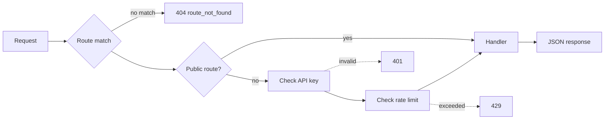

The demo API is a single Node.js process with no dependencies. It runs on Node's built-in `http` module and keeps all data in memory.

## Project layout

```text
.
├── app/                        # The demo API (ignored by Mintlify)
│   ├── package.json            # npm start, npm run dev, npm test
│   ├── src/
│   │   ├── server.js           # Routes, auth, rate limiting, errors
│   │   ├── data.js             # Cohorts, sample players, round generation
│   │   ├── analytics.js        # Aggregation, comparison, percentiles
│   │   └── webhooks.js         # Subscriptions, signing, delivery
│   ├── test/api.test.js        # End-to-end tests
│   └── examples/               # compare.js and webhook-receiver.js
├── openapi.yaml                # API contract; generates the API reference
├── docs.json                   # Mintlify site configuration
└── *.mdx, guides/, build/      # Documentation pages
```

## Run it

| Command | What it does |
| --- | --- |
| `npm start` | Starts the server on port 4000 |
| `npm run dev` | Starts the server and restarts it when files change |
| `npm test` | Runs the end-to-end tests against a server on a random port |

| Environment variable | Default | Purpose |
| --- | --- | --- |
| `PORT` | `4000` | Port to listen on |
| `ARCCOS_API_KEYS` | `sk_test_demo_123` | Comma-separated list of accepted API keys |
| `RATE_LIMIT_PER_MINUTE` | `120` | Requests allowed per key per minute |

## Request flow



Every route is one entry in the `routes` array in `app/src/server.js`:

```javascript
['GET', '/v1/players/:playerId/compare', ({ params, query }) => {
  const player = getPlayer(params.playerId);
  const window = windowParam(query);
  const cohort = cohortParam(query, 'cohort', 'tour_elite');
  return { window, ...compare(player, selectWindow(roundsByPlayer.get(player.id), window), cohort) };
}],
```

A handler returns the response body, or a `[status, body]` pair for statuses other than 200. To send an error, a handler throws an `ApiError`, which the server turns into the standard [error format](/guides/errors).

## How sample data is generated

`app/src/data.js` builds all data at startup from a fixed random seed, so every run returns the same responses.

1. **Cohorts** are defined by hand: stats plus strokes gained against scratch. Each cohort's scoring average is derived from its strokes gained total, so the two always agree.
2. **Players** have a handicap index. The generator interpolates between the two cohorts around that index to get the player's expected stats.
3. **Rounds**: for each of 24 rounds, the generator picks a course and a target score. It simulates each hole's fairway, green in regulation, bunker, and putts from the expected stats, then adjusts holes until they add up to the target.
4. **Strokes gained** per round is drawn around the player's expected values, then scaled so the four categories sum to the round's actual total.

Because stats come from simulated holes, a player's stats endpoint and their round detail stay consistent.

## How comparison works

`compare()` in `app/src/analytics.js`:

1. Aggregates the window's rounds into the shared stats shape.
2. For each stat, computes the gap and whether the player is ahead, using `higher_is_better`.
3. Estimates `cohort_percentile` with a normal distribution around the cohort average. Each stat's `spread` in `METRICS` sets the width.
4. Rebases strokes gained onto the cohort and sorts categories from the biggest loss to the biggest gain.
5. Writes the `insights` sentences from those gaps.

## Docs and code stay in sync through the spec

`openapi.yaml` describes every endpoint. Mintlify generates the [API reference](/api-reference/introduction) from it. When you change a route's parameters or response shape, update the spec in the same change. See [Extend the app](/build/extend).
